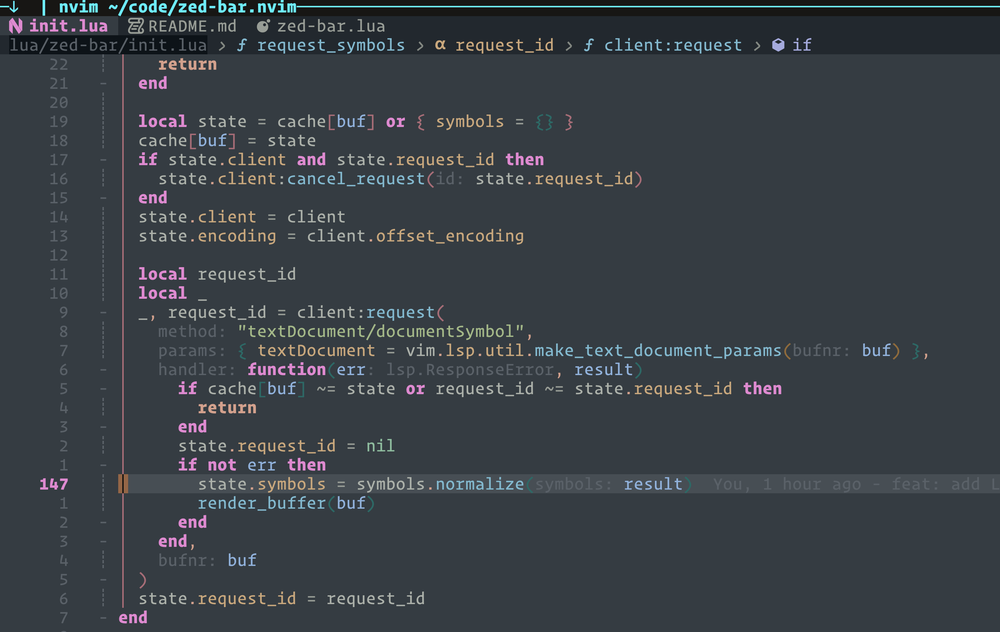

# zed-bar.nvim

A small, source-aware Neovim winbar inspired by Zed's breadcrumb layout.

It renders the current buffer path first, followed by the symbol hierarchy at the cursor. Symbols
come from Markdown headings, LSP, or Tree-sitter and include a Nerd Font icon plus a matching
highlight.

## Demo



## Features

- Current buffer path with a dimmed directory, a file icon, and modified/readonly flags
- Cursor-aware symbol breadcrumbs with Nerd Font icons, showing the enclosing scopes by default
- Clickable breadcrumbs and a sibling menu to jump between symbols at any level
- Width-aware truncation that keeps the file name and innermost symbol visible
- Dimmed breadcrumbs in inactive windows
- LSP, Tree-sitter, and Markdown heading sources
- Optional nvim-treesitter node parsing for more precise code-symbol matching
- Per-kind highlights for functions, classes, methods, variables, headings, control flow, and more
- Asynchronous LSP requests with cancellation and debounced updates
- No required plugin dependencies

## Requirements

- Neovim 0.12+
- A language server with `textDocument/documentSymbol` support or a Tree-sitter parser for code
  buffers (Markdown headings work without either)
- A Nerd Font for symbol icons

## Installation

### `vim.pack`

```lua
vim.pack.add({
  "https://github.com/nicholasxjy/zed-bar.nvim",
})

require("zed-bar").setup()
```

### lazy.nvim

```lua
{
  "nicholasxjy/zed-bar.nvim",
  config = function()
    require("zed-bar").setup()
  end,
}
```

For more precise Tree-sitter breadcrumbs, optionally add `nvim-treesitter`:

```lua
{
  "nicholasxjy/zed-bar.nvim",
  dependencies = { "nvim-treesitter/nvim-treesitter" },
  config = function()
    require("zed-bar").setup()
  end,
}
```

## Configuration

```lua
require("zed-bar").setup({
  -- "relative" matches the reference layout; "basename" shows only the file name.
  path = "relative",
  separator = " › ",
  padding = { left = 1, right = 1 },
  update_debounce = 24,
  symbol_debounce = 120,
  max_depth = 8,
  -- "scope": modules, classes, functions, headings, and data keys that enclose the cursor.
  -- "full": also bindings, calls, and control flow (`if`, `for`, `return`) at the cursor.
  detail = "scope",
  -- false hides symbol kind icons and the file icon.
  icons = true,
  -- Flags after the file name; set either to false to hide it.
  file_status = { modified = "●", readonly = "󰌾" },
  -- Draw inactive windows with the single `ZedBarInactive` highlight.
  dim_inactive = true,
  disabled_filetypes = {},
  -- Override individual symbol icons while keeping the remaining defaults.
  kinds = {
    Function = "󰊕 ",
    Class = " ",
  },
  -- Sources are tried in order; the first non-empty result wins.
  sources = function(buf)
    if vim.bo[buf].filetype == "markdown" then
      return { "markdown", "lsp", "treesitter" }
    end
    return { "lsp", "treesitter" }
  end,
  enabled = function(buf, win)
    return vim.bo[buf].buftype == ""
  end,
})
```

`path` can also be a function with the signature `function(buf, full_path): string`.

The file icon comes from [mini.icons](https://github.com/echasnovski/mini.icons) or
[nvim-web-devicons](https://github.com/nvim-tree/nvim-web-devicons) when either is installed.

When a window is too narrow, the breadcrumb gives up, in order: full directory names (`l/z/`),
outer symbols (collapsed into `…`), the directory, the end of the innermost name, and finally all
symbols, keeping the file name longest.

## Navigation

Click a symbol to open a menu of its siblings; click the file name to open the top-level outline.
Inside the menu:

| Key | Action |
| --- | --- |
| `<CR>`, double-click | Jump to the symbol |
| `h`, `<Left>` | Go up to the parent's level |
| `l`, `<Right>` | Open the children of the selected symbol |
| `q`, `<Esc>` | Close |

Use `/` to search the list. With the Tree-sitter source there is no sibling outline, so the menu
lists the enclosing scopes and clicking a symbol jumps to it directly.

| Command | Lua | Action |
| --- | --- | --- |
| `:ZedBar pick` | `require("zed-bar").pick()` | Open the menu at the innermost symbol |
| `:ZedBar parent` | `require("zed-bar").parent()` | Jump to the start of the enclosing symbol |
| `:ZedBar yank` | `require("zed-bar").yank()` | Copy `path › symbol › symbol` to the register |
| `:ZedBar toggle` | `require("zed-bar").toggle()` | Hide or show the winbar |
| `:ZedBar refresh` | `require("zed-bar").refresh()` | Request fresh LSP symbols (also `:ZedBarRefresh`) |
| `:ZedBar info` | `require("zed-bar").info()` | Show the sources, the one in use, and the LSP state |

No keys are mapped by default. For example:

```lua
vim.keymap.set("n", "<leader>;", function()
  require("zed-bar").pick()
end, { desc = "Breadcrumb menu" })
vim.keymap.set("n", "[s", function()
  require("zed-bar").parent()
end, { desc = "Enclosing symbol" })
```

## Symbol sources

Sources use fallback semantics: the first source that returns symbols at the cursor wins.

- `lsp`: uses `textDocument/documentSymbol` and supports nested `DocumentSymbol` and flat
  `SymbolInformation` responses. With `detail = "scope"`, a single-line variable or constant at the
  cursor is left out.
- `treesitter`: follows the syntax-node ancestors at the cursor. It recognizes functions, methods,
  classes, declarations, variables, calls, control flow, JSX elements, mappings, and other common
  node types. With `detail = "scope"`, an anonymous function or table is named after the binding,
  key, or call that holds it (`const App = () => {`, `describe("x", function()`), and bindings,
  calls, and control flow are otherwise left out. With the optional `nvim-treesitter` dependency, its node lookup is used when
  available and its `locals` query can select semantic ancestors; otherwise the built-in node
  lookup and ancestor matching remain the fallback.
- `markdown`: builds the current heading hierarchy from ATX and Setext headings while ignoring
  headings inside fenced code blocks.

The defaults are:

- Markdown buffers: `markdown → lsp → treesitter`
- Other file buffers: `lsp → treesitter`

Change the order or omit a source through `sources`. To always prefer Tree-sitter:

```lua
require("zed-bar").setup({
  sources = { "treesitter", "lsp" },
})
```

## Highlights

- `ZedBarNormal`
- `ZedBarDir` (directory part of the path)
- `ZedBarFile` (file name)
- `ZedBarModified`, `ZedBarReadonly`
- `ZedBarSeparator` (also the `…` of collapsed symbols)
- `ZedBarInactive` (everything in inactive windows when `dim_inactive` is on)
- `ZedBarKind{SymbolKind}` (for example, `ZedBarKindFunction`)
- `ZedBarIconKind{SymbolKind}` (for example, `ZedBarIconKindFunction`)

Every group is defined with `default = true`, so colors can be set before or after `setup()`.

```lua
vim.api.nvim_set_hl(0, "ZedBarDir", { fg = "#596171" })
vim.api.nvim_set_hl(0, "ZedBarFile", { fg = "#a9b1c3", bold = true })
vim.api.nvim_set_hl(0, "ZedBarSeparator", { fg = "#596171" })
```

## Performance

Cursor movement walks the cached LSP/Markdown data or the current Tree-sitter ancestor chain, then
updates a pre-rendered winbar string. LSP requests are asynchronous, debounced, and limited to
buffer text changes, writes, attach events, or explicit refreshes. An outdated in-flight request
is cancelled before a new one is sent. When LSP has no symbol at the cursor, Tree-sitter is used
automatically. The winbar row is reserved before the buffer is displayed, and identical renders
are skipped to avoid first-entry flicker and unnecessary redraws.

Hot paths use a compiled Tree-sitter name matcher, cached node-kind lookups, cached buffer paths,
pre-rendered separator/icon/highlight segments, and binary search over sorted LSP symbols.
Tree-sitter names are read from a bounded prefix of each node, so large ancestors such as whole
components cost the same as small ones, and an outdated tree is re-parsed incrementally before it
is used. Markdown headings are parsed incrementally from the nearest checkpoint above an edit.
Idle debounce timers and unloaded-buffer caches are released automatically.

## Testing

```sh
nvim --headless -u NONE -l tests/run.lua
nvim --headless -u NONE -l tests/benchmark.lua
```
